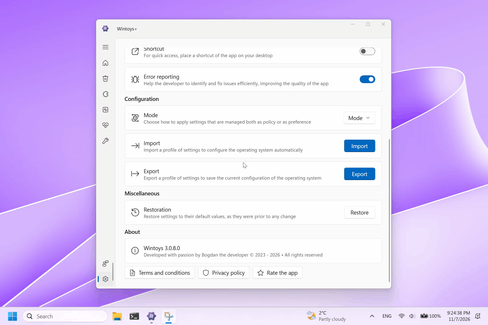
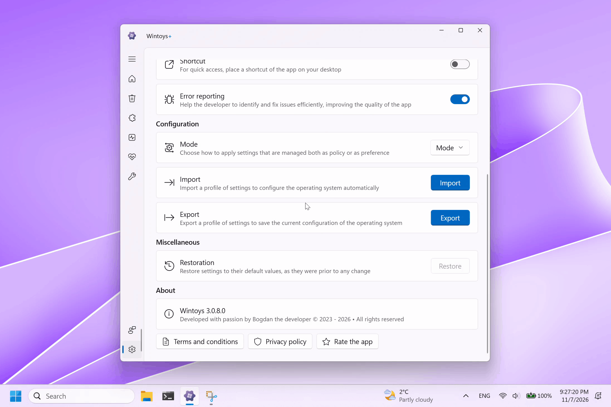
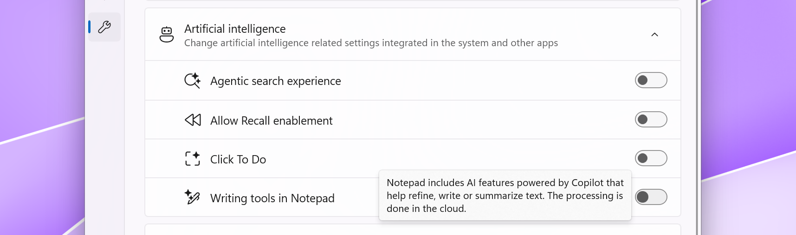
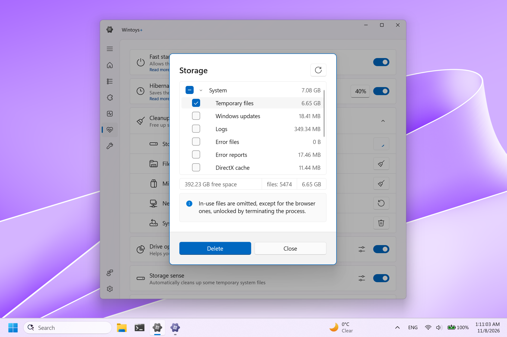
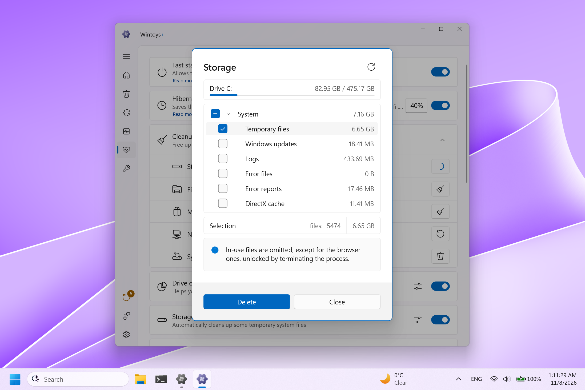
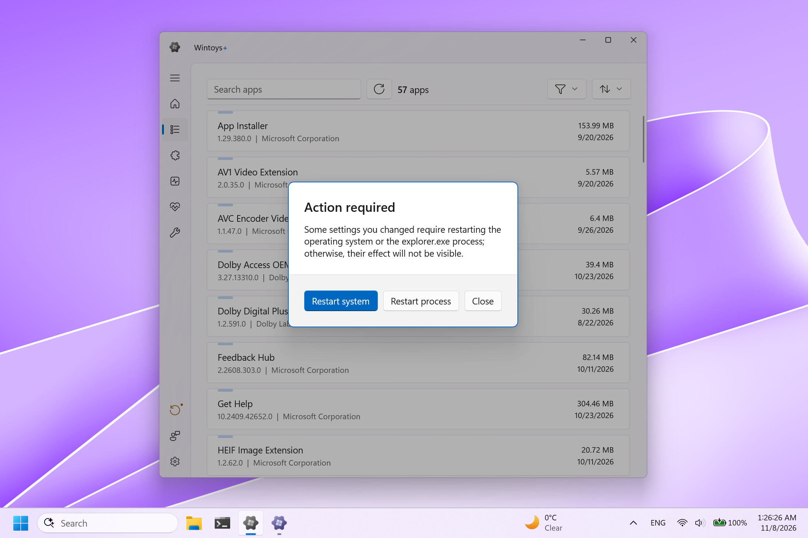
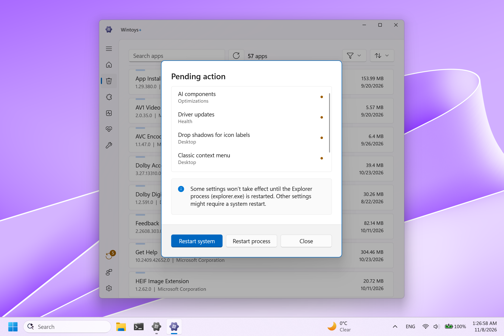

 

    this is a very special update into which went a lot of work

___

 

I am thrilled to announce this update! There are many new features, changes, and fixes, including the most-requested feature since launch, which is a bit late, but I'll explain below why it took so long. Considering there is so much to talk about, I felt like it was worth writing a few more words than the well-known [bullet point list](https://bogdan-patraucean.github.io/about/wintoys/changelog.html) of changes I've been maintaining since day one. This might be the biggest update yet.

_this text is **not** slop, it's written by me beginning at 00:30 AM; if there's any mistake... well... I can guarantee you it is mine_

___

### Profiles

What if I told you that this feature has been in the app for a while, just hidden behind the scenes? Why hidden? A serious Windows bug caught me by surprise just a day before launch, a bug that Microsoft fixed 3 years after my initial report and continuous pushing. It prevented developers from offering add-ons in their apps via the Store ecosystem: if an application would launch as administrator (as most Windows system utilities do), users simply couldn't acquire a license. You can trace the roots of this back to Windows 8, but for a more in depth technical look at the issue, I invite you to read how the entire story unfolded from a developer's perspective, [on Github](https://github.com/riverar/community-windows-bugs/issues/3).

**Wintoys+** is my response for those who appreciate and would like to support my work and years of effort. There were many wonderful people who sent me emails asking for a way they could donate to reward my work, but I felt like offering something more in return is the right thing to do. The add-on is now available in-app, and you can notice it if you look for a 🍕. I love pizza, and I hope you do too, but not the one with pineapple, of course.

The add-on will unlock **profiles**, the most-requested feature since launch. Offers the ability to export your current operating system configuration so you can later import it back with a single click, to apply all settings automatically. Do you need a backup so you can configure a fresh installation of Windows in no time? Would you like to share your configuration of settings with a friend so you help him get the most out of his system? Are you a system administrator or a technician who configures computers for a living? Profiles are the answer.

    <figure style="margin: 0; text-align: center; width: 48%">
        
        <figcaption>Export a profile</figcaption>
    </figure>
    <figure style="margin: 0; text-align: center; width: 48%">
        
        <figcaption>Import a profile</figcaption>
    </figure>

 

Profiles are saved as `.JSON` files, lightweight and human-readable, while keeping compatibility between different versions and builds of Windows. A profile exported on Windows 10 can be imported on Windows 11, a profile exported on a Copilot Plus PC can be imported on any other type of device, and so on. Incompatible settings are ignored by default, but tampering with the profile might result in corruption, in which case the import prevents you from using it.

While Wintoys+ works seamlessly on Windows 10, Microsoft unfortunately only patched the in-app purchase Store bug I mentioned above for Windows 11 (builds 26100.9278 or 26200.9278 and newer). The fact that Windows 10 is out of support might have contributed to this decision. However, once the license is acquired on a Windows 11 device, profiles will be unlocked on Windows 10 as the license is tied to your account.

I know the situation is annoying, but I did my best to make the fix possible.

You won't see dark UI patterns or annoying popups, nor the application will become worse or get ads to force you buy "a better version" like most products do after the honey moon phase - there is no better version, just the same application you already know, **+** an extension.

### Configuration mode

With the addition of this mode, I'm proud to announce that Wintoys is now the first Windows utility to properly sync policies with the Group Policy Editor. This new capability offers consistency between what the Group Policy Editor displays and which system settings are actually applied, meaning settings configured by the application will no longer be overriden by the Group Policy engine once every 90 minutes when Windows does its own sync or with every forced sync an organization might trigger. 

Settings that can be applied as policies will now go through the GPO engine instead of the registry. This means opening GPE will now display policies according to the settings applied in Wintoys, keeping both in sync. The sync works in the other direction as well: if an organization is forcing a policy to be configured differently than what's set in the application, the application will display the according state.

<figure style="margin: 0; display: flex; flex-direction: column; justify-content: center; align-items: center;">
    
    <figcaption>Configuration mode options</figcaption>
</figure>

 

There are 3 scenarios:
- a setting can be configured exclusively as a **preference** (the term Microsoft uses for settings applied normally by the user from the UI), in which case the configuration mode is not relevant as there's only one way of configuring it
- a setting can be configured exclusively as a **policy** (via Group Policy Editor - normally used by administrators in organizations or institutions), in which case the configuration mode is not relevant as there's only one way of configuring it
- a setting that can be configured both as a preference or as a policy, in which case the configuration mode becomes relevant, letting you specify the configuration mode of choice for when settings are applied

 

**Keep existing policies** is an option that prevents deleting existing policies if the configuration mode is set for preferences. Unchecked, will reset any policy that would overlapp with a preference, however, it might not always be a good idea, especially for a device that is managed by an organization, where other rules might apply.

Settings are only resynced when they are applied, so nothing will change after the update unless you decide to reapply them.

### Artificial intelligence

No, Wintoys is not getting a Copilot button in the navigation bar, but a section with integrated AI features or applications, so you have control over what runs on your system. When it comes to AI, Microsoft releases a new feature every 3 seconds (maybe that's why it took them 3 years to fix a bug), so because of how fast the landscape is changing, I decided not to rush the implementation of these features until they settle to a stable formula. Copilot was integrated into Windows, but now it is a separate app that can be easily uninstalled, making the existing policies to disable it deprecated, and so on.

<figure style="margin: 0; display: flex; flex-direction: column; justify-content: center; align-items: center;">
    
    <figcaption>Artificial intelligence section</figcaption>
</figure>

 

Most of the AI features are available on devices that have CPUs with an NPU, like a laptop with a Snapdragon or Panther Lake Intel processor, so they will only be displayed on those devices. If you don't see the artificial intelligence section at all, it means you don't have an NPU or even the Notepad application installed on your system, in which case you don't have to worry about AI on your device.

<figure style="margin: 0; display: flex; flex-direction: column; justify-content: center; align-items: center;">
    
    <figcaption>AI components option</figcaption>
</figure>

 

There is one more AI related option that has been added under the _Optimizations_ page, having a significant impact on performance. This service can consume a considerable amount of RAM, between 2 GB to 8 GB+, by running multiple process instances of WorkloadsSessionHost.exe in the background. On my Surface Pro 12 with 16 GBs of RAM, the memory usage dropped from 11 GBs to 5 GBs. The reason it may consume so much memory is because of the machine learning models that are loaded into memory to facilitate features like Recall or semantic search, even when these features are unused or disabled.

### Refined user experience

The interface was refined in key areas to offer clearer insights and more context, making it easier to decide what's best for your system:

    <figure style="margin: 0; text-align: center; width: 48%">
        
        <figcaption>Storage cleaner tool: before</figcaption>
    </figure>
    <figure style="margin: 0; text-align: center; width: 48%">
        
        <figcaption>Storage cleaner tool: after</figcaption>
    </figure>

 

The storage cleaner tool has now the drive C: stats at the top to better indicate how much of the drive storage is free or in use. Having a progress bar makes the information much more intuitive to grasp. The scan button style at the top right has also been changed to a more subtle one and the selection information (number of files and size) has been decluttered. You might see a slight increase in the total amount of storage than can be freed compared to the previous version - this difference is caused by the fact that scanning now includes hidden system files.

    <figure style="margin: 0; text-align: center; width: 48%">
        
        <figcaption>Pending settings: before</figcaption>
    </figure>
    <figure style="margin: 0; text-align: center; width: 48%">
        
        <figcaption>Pending settings: after</figcaption>
    </figure>

 

Some settings might require a restart of `explorer.exe` process or the entire system to take effect. From now on, the list of those pending settings will be displayed in chronological order as you change them. A counter has also been added in the navigation bar to indicate at a glance how many settings there are, without opening the dialog.

The restore settings dialog has got the same treatment.

### At last,

There would be much more to talk about, like the new privacy settings, the changes added to the home page, small improvements like CTRL + F support for searching apps and services, or the numerous fixes for various scenarios, but you can check these on the full list of changes [here](https://bogdan-patraucean.github.io/about/wintoys/changelog.html).

I hope you enjoyed reading this. Please let me know if you'd like to see this type of coverage for other upcoming important updates. I always respond to my emails. Since this update required fundamental under-the-hood changes, some issues might pop up despite weeks of testing. If you spot any, an email report would be greatly appreciated.

Now you will have to excuse me, as I'm going to order a pizza.

_Respectfully,_ 
_Bogdan_